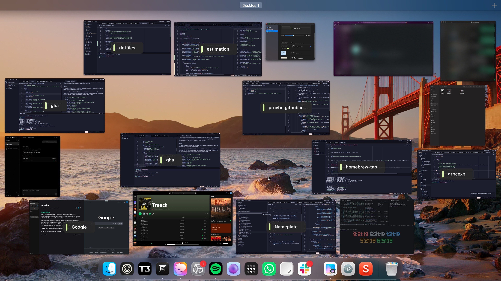
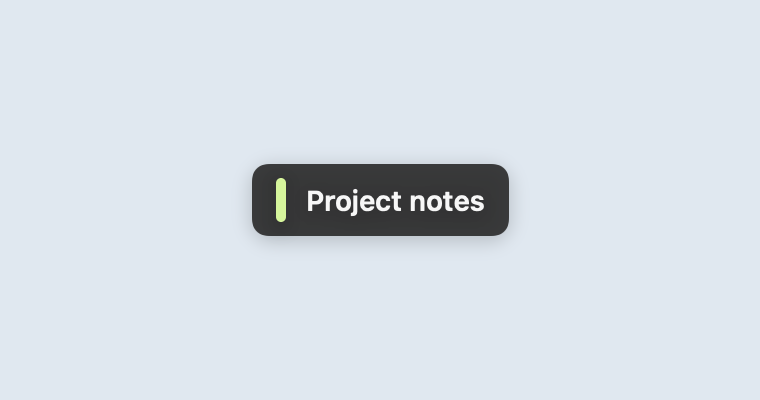
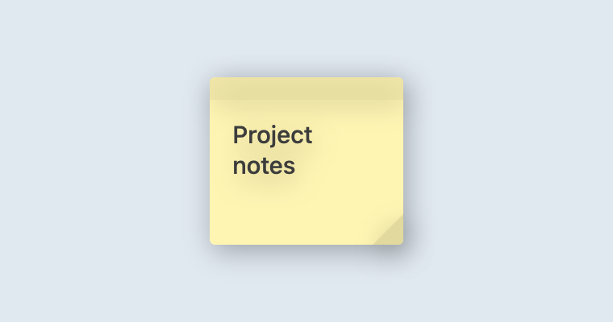
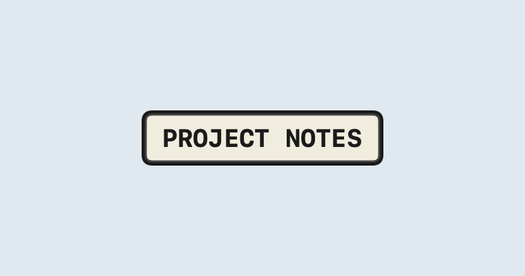

<p align="center">
  
</p>
<h1 align="center">Nameplate</h1>
<p align="center">See window titles at a glance in Mission Control.</p>

<table>
  <tr>
    <th width="50%" align="center">Without Nameplate</th>
    <th width="50%" align="center">With Nameplate</th>
  </tr>
  <tr>
    <td align="center">
      <a href="Assets/before.jpeg">
        
      </a>
    </td>
    <td align="center">
      <a href="Assets/after.jpeg">
        
      </a>
    </td>
  </tr>
</table>

Nameplate displays window titles on _plates_ in Mission Control. Choose which applications show nameplates, customize their appearance, and use window title rules to shorten or replace text.

## Installation

Requires an Apple Silicon Mac running macOS 26 or later.

### via brew

```sh
brew install --cask prnvbn/tap/nameplate
```

### via releases

[Download the latest DMG](https://github.com/prnvbn/Nameplate/releases/latest/download/Nameplate-macos-arm64.dmg), open it, and drag Nameplate into Applications.

## Customize nameplates

There are a few _nameplate_ presets available. If you have any ideas, feel free to [create an issue](https://github.com/prnvbn/Nameplate/issues).

<table>
  <tr>
    <th width="50%" align="center">Basic</th>
    <th width="50%" align="center">Accent Rail</th>
  </tr>
  <tr>
    <td align="center">
      <a href="Assets/styles/basic.png"></a>
    </td>
    <td align="center">
      <a href="Assets/styles/accent-rail.png"></a>
    </td>
  </tr>
  <tr>
    <th align="center">Sticky Note</th>
    <th align="center">Number Plate</th>
  </tr>
  <tr>
    <td align="center">
      <a href="Assets/styles/sticky-note.png"></a>
    </td>
    <td align="center">
      <a href="Assets/styles/number-plate.png"></a>
    </td>
  </tr>
</table>

Adjust **Nameplate size** for any preset.

## Edit window titles

Nameplate lets you process titles as well in case you want to show only the relevant information from the title.

- **Remove separator and following text** removes the last matching separator and everything after it.
- **Replace text** replaces exact matches.
- **Replace regex** replaces regular expression matches.
- **Add suffix** appends the specified text to the title.
- **Remove suffix** removes the specified text only when it occurs at the end of the title.

Rules run in order. Leave the replacement empty to remove matches.

---

Logo designed by [Chahak Surana](https://chahaksurana.com). Thanks for giving Nameplate its look!
