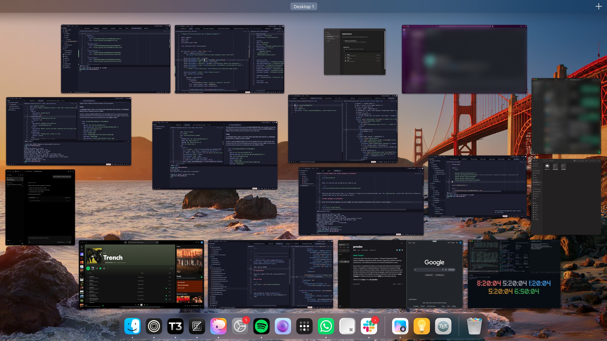

  

<h1 align="center">Nameplate</h1>

Readable window labels in macOS Mission Control.

Requires macOS 26 or later.

| Before                                                  | After                                                              |
| ------------------------------------------------------- | ------------------------------------------------------------------ |
|  |  |

TODO: improve README

---

Logo designed by [Chahak Surana](https://chahaksurana.com). Thanks for giving Nameplate its look!
